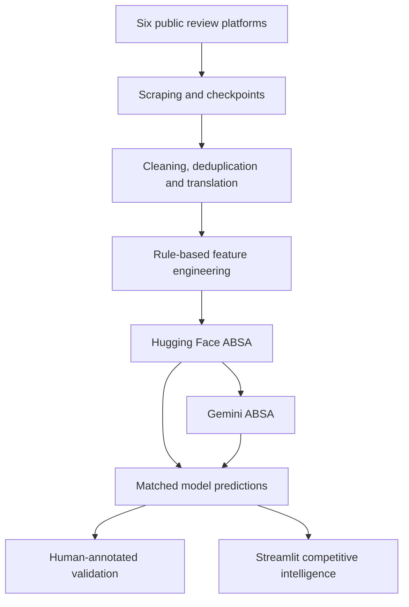

# AEGEAN Airlines | Customer Experience Intelligence

**Public Perception and Sentiment Benchmarking against Regional and European Airlines**

   

An end-to-end data science prototype for transforming public airline reviews into actionable, evidence-based customer experience insights. The project combines multi-source data engineering, multilingual NLP, aspect-based sentiment analysis (ABSA), human-annotated model evaluation and interactive competitive benchmarking.

## Project at a glance

| 7 airlines | 6 review sources | 25 classifications | 6 dashboard pages |
|:---:|:---:|:---:|:---:|
| Two benchmark groups | Multi-platform ingestion | 19 experience aspects + 6 segment/eligibility fields | Interactive analytics |

## Business objective

Identify recurring passenger experience themes, compare AEGEAN with European and global regional competitors, and highlight potential strengths and improvement opportunities using public reviews from January 2024 onwards.

| European benchmark | Global regional benchmark |
|---|---|
| AEGEAN Airlines | AEGEAN Airlines |
| Air France | Bangkok Airways |
| Lufthansa | Porter Airlines |
| Turkish Airlines | Virgin Australia |

## Architecture



The Gemini stage reads the HF export as its input; model predictions are evaluated separately. A Haiku pilot is also included in the experimental workflow.

## Technical highlights

- **Data engineering:** six-source ingestion (AirlineRatings, Flight-Report, eSky, Kayak, TripAdvisor and Trustpilot), schema harmonization, stable record keys, checkpointing and incremental updates.
- **Multilingual NLP:** language detection and English translation while retaining original review text and processing status.
- **Hybrid ABSA:** contextual rules, route evidence and Hugging Face sentiment inference, compared with generative LLM classification.
- **Model evaluation:** human annotations, accuracy, macro F1, aspect detection and model agreement; no fabricated ground truth.
- **Business intelligence:** matched-sample analytics, source and segment filters, time trends, feature-level evidence and configurable improvement priorities.

## Model evaluation

Previously reported human-annotated validation results:

| Metric | Hugging Face | Gemini |
|---|---:|---:|
| Overall accuracy | 0.738 | **0.964** |
| Overall macro F1 | 0.435 | **0.486** |
| Aspect detection F1 | 0.310 | **0.821** |

Gemini achieved higher reported scores on these three metrics. These are historical evaluation results, not recalculated for the current repository revision or dashboard filters. They should not be interpreted as performance on all passenger reviews.

## Interactive dashboard

| Page | Capabilities |
|---|---|
| Executive Overview | Key metrics, competitive sentiment and feature opportunities |
| EDA & Model Validation | Review coverage, languages, eligibility audit and model agreement |
| Overall Sentiment | Distributions, monthly trends and source-standardized comparisons |
| Feature Analysis | Aspect mentions, sentiment heatmaps and review evidence |
| Strategic Insights | Configurable pain-point prioritization |
| Thank You | Project author and LinkedIn QR |

## Quick start

From the repository root, using a Python environment:

```bash
python -m pip install -r Streamlit/requirements.txt
python -m streamlit run Streamlit/app.py
```

Open [localhost:8501](http://localhost:8501). The dashboard requires the following privately supplied analytical exports:

```text
Data/Output/Hugging Face/df_final_absa.csv
Data/Output/LLM/df_final_absa_gemini.csv
```

No API keys or model downloads are required for dashboard-only use. The code package does not include the production ABSA datasets; the dashboard does not generate placeholder reviews. For full pipeline setup, execution order and credentials, see the [technical project documentation](PROJECT_README.md).

## Repository structure

```text
Python Code/
  Scraping/          # Source-specific collection
  Data Cleaning/     # Consolidation and translation
  Hugging Face/      # Feature engineering and baseline ABSA
  LLM/               # Pilot and production LLM workflows
  Model Validation/  # Human-annotated evaluation
Data/
  Scraping/          # Private source exports
  Output/            # Private analytical outputs
Streamlit/           # Dashboard, dependencies and assets
```

Data directories may need to be created locally after cloning. See also the [Streamlit setup guide](Streamlit/README.md).

## Analytical integrity

The dashboard matches Hugging Face and Gemini reviews using `record_key`, restricts analysis to the seven benchmark airlines and dates from 2024 onwards, and excludes reviews explicitly flagged as long-haul or first class. Unknown haul classifications remain eligible unless first class is flagged. The sample size is computed from the actual inputs.

Public reviews are self-selected and platform coverage varies. Findings describe the collected sample rather than all passengers. The 2026 period is partial. Historical long-haul classifiers use a strict greater-than-six-hours threshold, whereas the intended definition is six hours or more; existing flags are preserved for reproducibility. See the technical documentation for denominators, limitations and maintenance guidance.

## Technology stack

Python · pandas · NumPy · Jupyter · Selenium · Playwright · Beautiful Soup · Apify · OpenAI translation · Hugging Face Transformers · PyTorch · Gemini · Anthropic pilot · scikit-learn · Plotly · Streamlit

## Author

**Michalis Fessas, PhD**  
Data science project | Airline customer experience and competitive intelligence

## Data and usage notice

This is an analytical prototype, not an official AEGEAN passenger survey. Public availability of reviews does not imply unrestricted redistribution rights. Production datasets, review text, credentials and checkpoints should remain private unless publication is authorized. No open-source license is asserted here; verify applicable permissions before reuse or redistribution.
